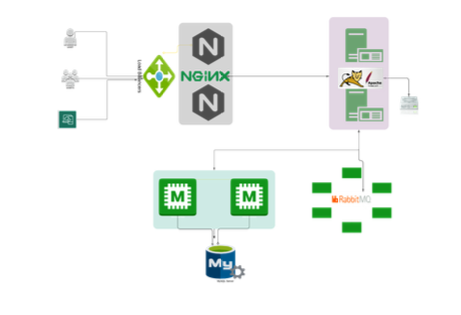
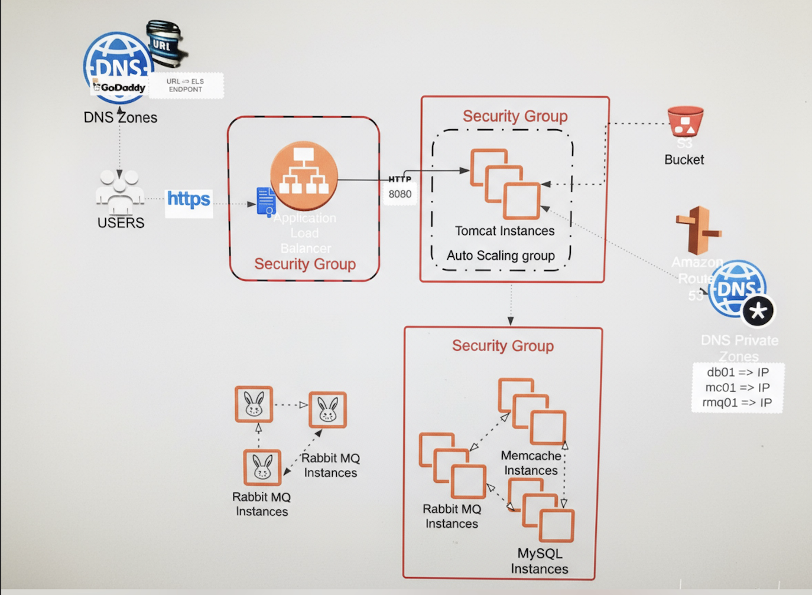

# VProfile DevOps: From Vagrant to AWS, CI/CD and Containers

[](https://github.com/mohammedinzi/vprofile-devops/actions/workflows/ci.yml)


A hands-on DevOps portfolio built around one real **3-tier Java application** (Nginx, Tomcat/Spring MVC, MySQL, Memcached, RabbitMQ). The same app is deployed four ways, and each way lives on its own branch, so you can see how the delivery model matures from manual servers to cloud and containers.

> **For recruiters and interviewers:** start with the [30-second summary](#30-second-summary), then the [skills map](#skills-demonstrated). Deeper talking points, trade-offs and lessons learned are in [`docs/INTERVIEW-GUIDE.md`](docs/INTERVIEW-GUIDE.md).

## 30-second summary

| Question | Answer |
|---|---|
| What did I build? | A full delivery path for one app: manual VMs, scripted VMs, AWS lift-and-shift, a Jenkins/SonarQube/Nexus pipeline, and Docker/ECR. |
| What did I own? | Architecture, provisioning scripts, AWS networking and security groups, the CI/CD pipeline, and the documentation. |
| What's the outcome? | Setup went from a long manual runbook to one command (`vagrant up`) locally, and a repeatable, load-balanced, autoscaled deployment on AWS. |
| What would I do next? | Terraform for the AWS layer, Kubernetes for the app tier, secrets in AWS Secrets Manager. See the [roadmap](#roadmap). |

## Architecture

**Local (Vagrant)**: five VMs that mimic a small data centre.

```
Browser -> Nginx (web01) -> Tomcat (app01) -> MySQL (db01) + Memcached (mc01) + RabbitMQ (rmq01)
```



**AWS (lift and shift)**: the app tier is stateless and autoscaled; data services sit in private subnets.

```
User -> Route 53 -> ALB (HTTPS, ACM cert) -> Auto Scaling Group (Tomcat EC2)
                                              -> private subnet: MySQL, Memcached, RabbitMQ
Build artifact (WAR) -> S3 -> pulled by EC2 via IAM role
```



## The journey: one branch per stage

| Stage | Branch | What it demonstrates |
|---|---|---|
| 1. Manual provisioning | [`vagrant-manual`](../../tree/vagrant-manual) | Understanding every service before automating it. Step-by-step runbooks. |
| 2. Automated provisioning | [`vagrant-automation`](../../tree/vagrant-automation) | Infrastructure as Code with Vagrant and shell provisioning scripts. |
| 3. Cloud migration | [`awsliftandshift`](../../tree/awsliftandshift) | EC2, ALB with ACM TLS, ASG, Route 53 private DNS, S3, IAM roles, security-group design. |
| 4. CI/CD | [`atom`](../../tree/atom) | Jenkins, Maven, Checkstyle, SonarQube quality gate, Nexus artifact versioning, Slack alerts. |
| 5. Containers | [`atom-docker-ecr`](../../tree/atom-docker-ecr) | Multi-stage Dockerfiles, docker-compose for the full stack, image push to Amazon ECR. |
| Reference | [`prerequisites`](../../tree/prerequisites) | Tooling and environment setup notes. |
| Integration | `develop` / `main` | Integration branch and stable release. |

## Skills demonstrated

| Area | Evidence in this repo |
|---|---|
| Linux and networking | CentOS/Ubuntu/Amazon Linux provisioning, service units, firewall and security-group rules |
| IaC / config management | Vagrantfiles, shell provisioning, EC2 user data, Ansible playbooks in [`ansible/`](ansible) |
| AWS | EC2, VPC subnets, ALB + ACM, ASG + launch templates, Route 53, S3, IAM (branch `awsliftandshift`) |
| CI/CD | [`Jenkinsfile`](Jenkinsfile): build, unit and integration test, Checkstyle, Sonar quality gate, Nexus publish; GitHub Actions in [`.github/workflows/ci.yml`](.github/workflows/ci.yml) |
| Containers | Multi-stage builds and compose files (branch `atom-docker-ecr`) |
| Security hygiene | No secrets in git (env-driven config), secret scanning with gitleaks in CI, least-privilege security groups |
| Troubleshooting | Documented real failures: full disks, wrong IPs, failing quality gates, sticky-session logins behind an ALB |

## Quick start

Local lab (needs Vagrant and VirtualBox, or VMware on Apple Silicon):

```bash
git clone https://github.com/mohammedinzi/vprofile-devops.git
cd vprofile-devops
git checkout vagrant-automation
cd vagrant/automated/provisioning_WinMacIntel   # or provisioning_MacOSM1
vagrant up
```

Build and test the app only (Java 17, Maven 3.9):

```bash
mvn -B clean verify        # produces target/vprofile-v2.war
```

## Configuration and secrets

All settings in [`src/main/resources/application.properties`](src/main/resources/application.properties) read environment variables, with safe lab defaults:

| Variable | Purpose | Default |
|---|---|---|
| `DB_HOST`, `DB_PORT`, `DB_NAME` | MySQL location | `db01`, `3306`, `accounts` |
| `DB_USER`, `DB_PASSWORD` | MySQL credentials | `admin`, `change-me` |
| `RABBITMQ_HOST`, `RABBITMQ_USER`, `RABBITMQ_PASSWORD` | Message broker | `rmq01`, `test`, `change-me` |
| `MEMCACHED_HOST` | Cache | `mc01` |
| `APP_ADMIN_USER`, `APP_ADMIN_PASSWORD` | App admin login | `admin_vp`, `change-me` |

In real environments these come from Jenkins credentials or AWS SSM Parameter Store / Secrets Manager, never from the repo.

## CI/CD pipeline

```
Checkout -> Build -> Unit test -> Integration test -> Checkstyle -> SonarQube + quality gate -> Publish WAR to Nexus
```

The Nexus host is a pipeline parameter, builds are time-limited, test reports are published, and the workspace is cleaned afterwards. GitHub Actions runs build, test and a secret scan on every push and pull request.

## Roadmap

- [x] Manual and automated Vagrant provisioning
- [x] AWS lift and shift
- [x] Jenkins, SonarQube, Nexus, Slack pipeline
- [x] Docker and docker-compose, ECR push
- [x] GitHub Actions CI and secret scanning
- [ ] Terraform for the AWS layer
- [ ] Kubernetes (EKS) deployment with Helm
- [ ] Monitoring with Prometheus and Grafana
- [ ] Secrets in AWS Secrets Manager

## About

Built by **Mohammed Inzemam** as a practical DevOps learning and portfolio project. Connect on [GitHub](https://github.com/mohammedinzi).

Licensed under the [MIT License](LICENSE).
